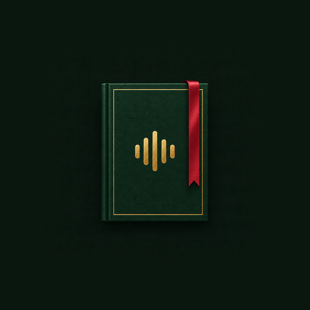

# Audioknihy – přehrávač audioknih pro Plex

🇬🇧 [English version](README.md)

Android přehrávač audioknih z vašeho Plex serveru. **Každá kniha si sama pamatuje, kde jste skončili**, takže můžete střídat několik knih a vždy pokračovat na správném místě.

Dělaný na poslech v posteli, v autě i doma: tmavý vzhled, velká tlačítka, časovač vypnutí, Android Auto.

## Co umí

- **Rozposlouchané** – všechny načaté knihy a kolik zbývá. Klepnutím na knihu se otevře detail s kapitolami, tlačítkem ▶ pokračujete. Řazení podle naposledy přehraných, názvu, autora, toho, kolik zbývá, nebo rozposlouchanosti.
- **Pozice u každé knihy zvlášť** – ukládá se každých 5 s a při každé pauze, přepnutí knihy, vypnutí časovačem, odpojení sluchátek i zavření aplikace. Po pauze delší než 3 minuty se přehrávání vrátí o pár sekund. Rychlost se pamatuje u každé knihy.
- **Stužka-záložka** – každá kniha má hedvábnou stužku ve své barvě, která vychází z horní hrany obalu; její délka ukazuje, kolik máte za sebou.
- **Knihovna** – autoři se rozbalují a sbalují, hledání nevadí chybějící diakritika. Knihy rozdělené do složek `CD 1`, `CD 2`… se spojí do jedné.
- **Kapitoly** – vložené kapitoly souborů M4A/M4B (Nero `chpl`), jinak soubor = kapitola.
- **Přehrávač** – skok zpět/vpřed (nastavitelný), předchozí/další kapitola, rychlost 0,5×–3,0×.
- **Časovač vypnutí** – 15/30/45/60 min nebo do konce kapitoly, na konci ztlumí, zatřesením telefonu se prodlouží.
- **Vizualizace** – Vlny, Stereoskop (u mono audioknih fázový obrazec), Spektrum, Aura (prstenec spektra kolem obalu) a Hedvábí. Zvuk se bere přímo z přehrávače, bez oprávnění k mikrofonu.
- **Obaly** – obal z Plexu; když chybí, aplikace ho dohledá na Apple Books (český obchod), Google Books a Open Library, jinak použije obrázek autora. Obal můžete najít i ručně (⋮ → Najít obal).
- **Označit jako dokončené / nepřehrané** – promítne se i do Plexu.
- **Synchronizace s Plexem** – pozice se hlásí i do Plexu (při výpadku sítě se pošle později). Knihy rozposlouchané v Plexampu se po prvním přihlášení objeví v Rozposlouchaných.
- **Ovládání odkudkoli** – notifikace, zamčená obrazovka, tlačítka na sluchátkách, Android Auto (Rozposlouchané / Knihovna, další/předchozí = kapitoly).
- **Automatické aktualizace** – aplikace kontroluje novou verzi na GitHubu, stáhne ji a otevře instalaci (potvrdíte ji). Dá se vypnout v Nastavení.
- **Jazyk** – čeština nebo angličtina, přepínatelné v Nastavení (nebo podle telefonu).
- **Vzhled** – tři rozvržení (Stužka, Police, Kompakt), každé s pěti barevnými vzhledy (Plátno, Půlnoc, Bordó, Noční modř, Den). Česky a anglicky.

## Požadavky

- Android 8.0 nebo novější
- Plex Media Server s audioknihami v **hudební** knihovně (kniha = složka, soubory = části/kapitoly)

## Instalace

1. Sestavte APK (viz níže) nebo si ho stáhněte z Releases.
2. Otevřete APK v telefonu a povolte instalaci z tohoto zdroje.
3. Spusťte **Audioknihy**, klepněte na **Přihlásit přes Plex**, přihlaste se v prohlížeči a vraťte se.
4. Vyberte server a knihovnu s audioknihami.

### Android Auto

Android Auto ukazuje jen aplikace z Google Play, pokud nezapnete jedno nastavení. Stačí jednou:

1. V telefonu **Nastavení → Android Auto**.
2. Sjeďte dolů a **10× klepněte na „Verze“**, dokud se neobjeví nastavení pro vývojáře; potvrďte.
3. **⋮ → Nastavení pro vývojáře** → zapněte **Neznámé zdroje**.
4. Odpojte a znovu připojte telefon k autu.

## Sestavení

Potřebujete JDK 17+ a Android SDK (API 35).

```bash
./gradlew testDebugUnitTest   # testy
./gradlew assembleDebug       # ladicí APK
```

Podpis release verze je volitelný. V kořeni projektu vytvořte `keystore.properties` (je v `.gitignore`, nikdy ho necommitujte):

```properties
storeFile=release.keystore
storePassword=...
keyAlias=audioknihy
keyPassword=...
```

Klíč dejte do `app/` a spusťte `./gradlew assembleRelease`. **Klíč a hesla si zálohujte** – bez nich nepůjde nainstalovat aktualizaci přes stávající aplikaci.

> Build výstupy jsou přesměrované do `%LOCALAPPDATA%/AudioknihyBuild` (projekt původně ležel ve složce synchronizované přes OneDrive). Dá se to změnit v `build.gradle.kts`.

## Technologie

Kotlin, Jetpack Compose (Material 3), Media3 (ExoPlayer + MediaLibraryService), Room, Hilt, OkHttp + Moshi, WorkManager, DataStore, Coil.

Jádro (skládání knih, pravidla pozice, kapitoly, časovač, přehrávací relace, fronta hlášení) je pokryté testy: `./gradlew testDebugUnitTest`.

Návrh: [`docs/superpowers/specs`](docs/superpowers/specs), plán stavby: [`docs/superpowers/plans`](docs/superpowers/plans).

## Soukromí

Aplikace komunikuje jen s vaším Plex serverem a plex.tv (přihlášení). U knih bez obalu posílá název a autora do Apple (iTunes Search), Google Books a Open Library. Žádná analytika, žádné reklamy.

## Poděkování

Inspirováno projektem [Chronicle](https://github.com/mattttvaughn/chronicle) (bez převzatého kódu). Nejde o produkt společnosti Plex Inc.
